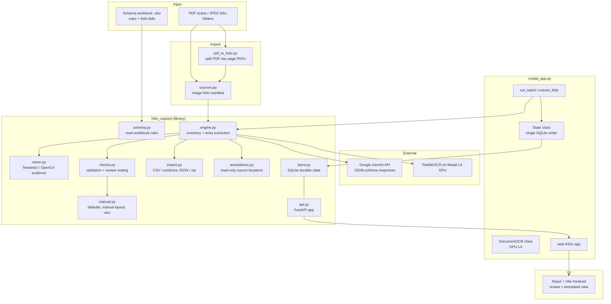
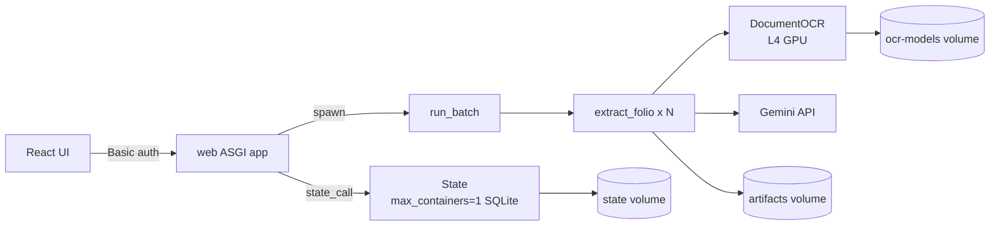

# Understanding — LPS Land Records Digitization (Folio Capture)

A working mental model of this codebase: what it does, how the pieces fit, the rules the
system obeys, and where it currently stands.

---

## 1. Purpose

Turn scanned **Northern Ireland Land Registry folios** (PDFs or JPEG page sets) into
**structured, evidence-backed capture data** matching a supplied manual-capture workbook
(`LPS Folio Digitization Data Capture, Rules and Design v7.11 2024-11-24 Schema.xlsx`).

Guiding principle repeated throughout the code and docs:

> Model output never bypasses human review. Every value is traceable to source evidence or
> an explicit workbook rule. Nothing is a calibrated probability of correctness.

Supported detailed entry types (the "six types"):

| Entry type | Code |
|---|---|
| Transfer of Part | `FT_TOP` |
| Description of Land | `FT_DESCRIPTION_OF_LAND` |
| Covenants | `FT_CONVENANT` |
| Easements | `FT_EASEMENT` |
| Leasehold Yearly Rent | `FT_LHOLD_YRLR_RENT` |
| Leasehold Particulars | `FT_LHOLD_PARTICULARS` |

---

## 2. High-level architecture



Two deployment surfaces:

- **Local library + experiment scripts** — deterministic, checkpointed, no auto-deploy.
- **Modal app** — private workers: a GPU OCR class, CPU extraction workers, one serialized
  SQLite state writer, and an authenticated ASGI web app serving the React UI.

---

## 3. Data model & pipeline

### 3.1 Source ingestion
- [pdf_to_folio.py](file:///d:/LPS%20Land%20Records%20Digitization%20AI%20Assisted%20Extraction/land_records_digitization-main/pdf_to_folio.py) splits each PDF into numbered page PDFs (`pdfseparate` + `pdfinfo`).
- [sources.py](file:///d:/LPS%20Land%20Records%20Digitization%20AI%20Assisted%20Extraction/land_records_digitization-main/folio_capture/sources.py) handles **image folios**: each JPEG folder = one folio. Pages sort by leading
  filename number; duplicate/unnumbered pages are rejected; gaps become explicit review issues.
  JPEGs keep original bytes and are EXIF-orientation-corrected, native pixel dimensions preserved
  (normalized 0–1000 coords apply to all paper sizes).
- Limits: 1–200 pages, ≤ 50 MB per source.

### 3.2 Per-folio processing ([engine.py](file:///d:/LPS%20Land%20Records%20Digitization%20AI%20Assisted%20Extraction/land_records_digitization-main/folio_capture/engine.py))
`process_folio` runs in stages, each checkpointed under `checkpoints/<fingerprint>/`:

1. **Render + OCR** — page PNGs, Tesseract words (with ink-density blank detection and
   Laplacian sharpness), plus PaddleOCR layout/tables/words on GPU.
2. **Inventory (Gemini)** — `inventory_folio` identifies: legal folio metadata (folio number,
   county, register type, dates), every logical entry, continuations, exclusions, and a
   **`page_entry_number`** (manual Entry No assigned by counting substantive entries per page).
   Allowed detailed types + secondary types (Ownership, Charge, Notes, Appurtenances, Unknown).
3. **Per-entry extraction (Gemini, 12 threads)** — `extract_entry` sends full-page context +
   entry crops and returns records with fields, `basis`, tight source boxes, and quotes.
   Deterministic post-processing follows (see §4).
4. **Independent checks** — [vision.py](file:///d:/LPS%20Land%20Records%20Digitization%20AI%20Assisted%20Extraction/land_records_digitization-main/folio_capture/vision.py) computes OCR agreement, deletion-stroke geometry,
   uncovered-text detection; blank pages the model omitted get synthesized `page_status` entries.
5. **Publish** — `extracted.json` + `extracted.csv` written atomically.

### 3.3 Entry record shape
- `Proposal` / entry: `id, parent_id, entry_type, status, regions[], label, page_entry_number`.
- `status`: `""`=active, `Y`=struck, `C`=cancelled, `U`=uncertain, `B`=blank, `F`=cover.
  Any non-empty status ⇒ attributes suppressed.
- `attributes`: table → list of records (repeated entities). Fields carry `_record_id`/`_parent_id`.
- `field_evidence`: per `TABLE[i].FIELD` → `{basis, value, sources[], rule/rule_source}`.
- `basis`: `observed | default | derived | absent | inapplicable | unreadable | lookup | human | input`.

### 3.4 Storage ([store.py](file:///d:/LPS%20Land%20Records%20Digitization%20AI%20Assisted%20Extraction/land_records_digitization-main/folio_capture/store.py))
SQLite with four tables: `sources`, `batches`, `folios` (two payload columns: `payload` = current
with human corrections, `extracted` = immutable original), `audit`. Single-writer lock. Every
review mutation: revision check → before/after audit row → idempotent by `action_id`.

---

## 4. Core rules & invariants (the "contract")

**Schema-driven, not hard-coded** ([schema.py](file:///d:/LPS%20Land%20Records%20Digitization%20AI%20Assisted%20Extraction/land_records_digitization-main/folio_capture/schema.py)):
tables/fields/groups/rules are read from the workbook. Lookup IDs (`FOLIO_ID`, `FOLIO_ENTRY_ID`,
...) are never inferred. In the `manual-v2` profile lookups are disabled and printed references
are kept; in `database` profile they route to `visible_references` + `LPS_LOOKUP_REQUIRED`.

**Defaults are rule-gated** ([manual.py](file:///d:/LPS%20Land%20Records%20Digitization%20AI%20Assisted%20Extraction/land_records_digitization-main/folio_capture/manual.py)): a model "default" is accepted only if
`default_value(rule)` matches; otherwise cleared and flagged `UNVERIFIED_DEFAULT`.

**Validation & review routing** ([checks.py](file:///d:/LPS%20Land%20Records%20Digitization%20AI%20Assisted%20Extraction/land_records_digitization-main/folio_capture/checks.py)): flags such as `MISSING_FIELD_EVIDENCE`,
`UNANCHORED_VALUE`, `VALUE_NOT_CONFIRMED_BY_OCR`, `INVALID_DATE/POSTCODE/COUNTY`,
`CHECK_CANCELLATION_SCOPE`, `WEAK_OCR`, `OCR_DISAGREEMENT`, `REGISTRATION_DATE_MISSING`.
`risk_band` = `structural` or `review`. **No auto-accept** — automatic acceptance is disabled.

**Geometry guards**: `rectangle()` enforces 0–1000 boxes; `registration_outside_entry` triggers a
scoped 4-field registration recheck when evidence sits in a different vertical block (prevents
borrowing a neighbour's registration date). Deletion strokes flag review but never suppress valid text.

**Manual profile normalization** (deterministic, on saved evidence, never on labels):
address components → `ADDRESSABLE_MANUAL_ADDR`; registration references moved from `FT_ENTRY_DOC`
to `FT_MARGINAL_NOTE_DOC` by geometry; party/org classification; local party sequence IDs;
county label standardisation; document-label expansion.

---

## 5. Exports

| Export | Module | Notes |
|---|---|---|
| CSV (one per folio) | [export.py](file:///d:/LPS%20Land%20Records%20Digitization%20AI%20Assisted%20Extraction/land_records_digitization-main/folio_capture/export.py) `csv_bytes` | meta columns + one column per schema field + per-table JSON |
| Evidence JSON | engine `extracted.json` | lossless, full traceability |
| Batch ZIP | `batch_zip` | CSVs + `manifest.json` |
| Manual 6-sheet XLSX | [manual.py](file:///d:/LPS%20Land%20Records%20Digitization%20AI%20Assisted%20Extraction/land_records_digitization-main/folio_capture/manual.py) `manual_xlsx_bytes` | Page No/Entry No across top; #/TABLE/FIELD down left; one entry/parcel per column. Runtime uses openpyxl. |
| Standalone workbook + previews | [export_manual.mjs](file:///d:/LPS%20Land%20Records%20Digitization%20AI%20Assisted%20Extraction/land_records_digitization-main/export_manual.mjs) | Node + `@oai/artifact-tool`, local artifact runtime only |

Layout template: [manual_layout.json](file:///d:/LPS%20Land%20Records%20Digitization%20AI%20Assisted%20Extraction/land_records_digitization-main/folio_capture/manual_layout.json). Text cells are forced to string type so OCR values
starting with `=` are not treated as formulas.

---

## 6. Human review workflow

1. Import source → select folios → **Start extraction**.
2. Batch publishes CSV + ZIP when done; failed folios appear in the manifest and can be **resumed**.
3. Reviewer confirms folio identity, then per entry can **edit fields, adjust/add/split/merge
   regions, acknowledge structural gaps, re-extract, approve**.
4. Fully reviewed exports require every selected folio finished **and** every entry approved.
5. **Annotated view** ([AnnotatedView.tsx](file:///d:/LPS%20Land%20Records%20Digitization%20AI%20Assisted%20Extraction/land_records_digitization-main/frontend/src/AnnotatedView.tsx), [annotations.py](file:///d:/LPS%20Land%20Records%20Digitization%20AI%20Assisted%20Extraction/land_records_digitization-main/folio_capture/annotations.py)) is read-only: image left,
   attributes right, colour-numbered source marks. Solid = OCR-located (unique literal match),
   dashed = model-only box. It makes **no model calls** and does not alter scans.

Two CSVs stay separate throughout: **extracted** (original) vs **current** (human corrections).

Security ([api.py](file:///d:/LPS%20Land%20Records%20Digitization%20AI%20Assisted%20Extraction/land_records_digitization-main/folio_capture/api.py)): HTTP Basic on everything; same-origin enforcement on mutations;
`no-store`, `nosniff`, `DENY` headers; no token reaches the browser. `reextract_result` can only be
submitted by the private worker.

---

## 7. Local experimentation & evaluation tooling

The scoring loop is deliberately separated from extraction — **only evaluators read manual answers**.

- [iterate_capture.py](file:///d:/LPS%20Land%20Records%20Digitization%20AI%20Assisted%20Extraction/land_records_digitization-main/iterate_capture.py) — checkpointed local extraction experiments. `--extract` actually calls Gemini.
  Cache key = fingerprint(model, baseline archive, schema hash, engine/manual/schema/checks code).
- [evaluate_manual.py](file:///d:/LPS%20Land%20Records%20Digitization%20AI%20Assisted%20Extraction/land_records_digitization-main/evaluate_manual.py) — scores workbook vs extraction (links manual columns to entries, incl. parcel children).
- [evaluate.py](file:///d:/LPS%20Land%20Records%20Digitization%20AI%20Assisted%20Extraction/land_records_digitization-main/evaluate.py) — generic exact-match + one-sided 95% Wilson lower bound vs a labels file.
- [refresh_inventory.py](file:///d:/LPS%20Land%20Records%20Digitization%20AI%20Assisted%20Extraction/land_records_digitization-main/refresh_inventory.py) — re-inventories saved source pages (cached by fingerprint).
- [apply_inventory.py](file:///d:/LPS%20Land%20Records%20Digitization%20AI%20Assisted%20Extraction/land_records_digitization-main/apply_inventory.py) — reconciles fresh inventories with saved entries by source **geometry**,
  never labels. Modes: `--numbers-only`, `--regions-only`, `--fresh-captures-only`.
- Tests: [test_capture.py](file:///d:/LPS%20Land%20Records%20Digitization%20AI%20Assisted%20Extraction/land_records_digitization-main/test_capture.py), [test_manual.py](file:///d:/LPS%20Land%20Records%20Digitization%20AI%20Assisted%20Extraction/land_records_digitization-main/test_manual.py), [test_iteration.py](file:///d:/LPS%20Land%20Records%20Digitization%20AI%20Assisted%20Extraction/land_records_digitization-main/test_iteration.py),
  [test_folio_images.py](file:///d:/LPS%20Land%20Records%20Digitization%20AI%20Assisted%20Extraction/land_records_digitization-main/test_folio_images.py), [test_pdf_to_folio.py](file:///d:/LPS%20Land%20Records%20Digitization%20AI%20Assisted%20Extraction/land_records_digitization-main/test_pdf_to_folio.py) — mocked API, no external calls.

---

## 8. Deployment ([modal_app.py](file:///d:/LPS%20Land%20Records%20Digitization%20AI%20Assisted%20Extraction/land_records_digitization-main/modal_app.py))



- Volumes: `folio-artifacts`, `folio-state`, `folio-ocr-models`. Secrets: `folio-login`, `folio-gemini`.
- **`State` must stay at `max_containers=1`** (single SQLite writer). A comment explicitly warns to
  move to PostgreSQL before scaling writers.
- **Drain before redeploy**: finish/interrupt active work and stop the app so the state writer flushes.
- `seed` entrypoint ingests PDFs from `data/` (or a folio root of JPEGs) and optionally starts a batch.
- Pipeline version constant `PIPELINE_VERSION` in [engine.py](file:///d:/LPS%20Land%20Records%20Digitization%20AI%20Assisted%20Extraction/land_records_digitization-main/folio_capture/engine.py) — currently `folio-v3-image-input` —
  participates in the cache fingerprint, so code/model changes invalidate cached entries.

---

## 9. Current status (from README + [MANUAL_CAPTURE_PROGRESS.md](file:///d:/LPS%20Land%20Records%20Digitization%20AI%20Assisted%20Extraction/land_records_digitization-main/MANUAL_CAPTURE_PROGRESS.md))

Latest delivery: `output/manual-v3-delivery/Manual_Format_Extraction.xlsx` (+ report, evaluation
CSVs/JSON, `repeatability.json`, evidence JSONs, `artifact_sha256.json`).

| Metric (67 labelled occurrences / 965 expected populated fields) | Value |
|---|---:|
| Correct | 898/965 = 93.1% (baseline 612/965 = 63.4%) |
| Populated | 943/965 = 97.7% |
| Agreement among filled expected | 898/943 = 95.2% |
| Precision incl. manual-blank extras | 898/1012 = 88.7% |
| Entry numbers agreeing | 67/67 |
| Both manuals combined | 898/1317 = 68.2% |

**Important caveats** (stated repeatedly in the source docs):
- These are **agreement scores against the supplied manual**, not independently adjudicated truth.
- A full fresh Flash repeat scored **888/965 (92.0%)** — evidence of run-to-run variance; 93.1% is
  not a guaranteed fresh-run result.
- **Final-configuration full-batch repeatability is NOT yet established.**
- **No live deployment has occurred.** Changes remain local.
- 27 entries from a second workbook remain untested — its source PDFs were not found.
- Outstanding: numbering edge cases, remaining source/benchmark disagreements (e.g. currency
  pre-decimal rules, spelling conflicts), absent sources, deployment.
- The 99.5% target is not established; automatic acceptance stays disabled.

---

## 10. How to run (local)

```bash
python3 -m venv .venv
.venv/bin/pip install -r requirements.txt          # deps: modal, fastapi, google-genai, openpyxl, pillow, numpy, opencv, ...
.venv/bin/python pdf_to_folio.py                    # split data/*.pdf into page PDFs

# non-model local iteration
.venv/bin/python iterate_capture.py
.venv/bin/python test_manual.py
CANDIDATE_ZIP=output/manual-v2/current.zip EVALUATION_OUTPUT=output/manual-v2/evaluation \
  .venv/bin/python evaluate_manual.py

cd frontend && npm ci && npm run build              # React workspace
```

Deploy (Modal):

```bash
.venv/bin/modal deploy modal_app.py
.venv/bin/modal run modal_app.py::seed --start-batch
```

---

## 11. Design philosophy in one paragraph

This is a **"code-vs-data" system**: the engine is jurisdiction-agnostic and schema-agnostic; the
capture rules, tables, defaults and manual layout are **data** read from the supplied workbook.
Extraction is **grounded and additive** — an LLM proposes, but deterministic OCR/geometry checks,
rule-gated defaults, and a mandatory human review layer decide what is trusted. Every value carries
provenance (basis + sources + rule); nothing is a fake probability; and the evaluation harness is
strictly quarantined from the extraction pipeline so accuracy claims are honest.
